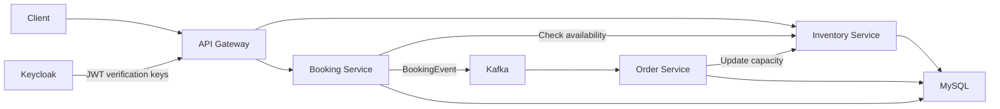

# Ticketing System

A Java 21 and Spring Boot backend learning project for event inventory, ticket bookings, and asynchronous order processing. Four services combine REST communication, Kafka events, a JWT-authenticated API gateway, and relational persistence.

## Architecture



| Service | Port | Responsibility |
| --- | --- | --- |
| Inventory Service | 8080 | Event and venue queries, remaining-capacity updates, Flyway schema migrations |
| Booking Service | 8081 | Customer lookup, availability checks, price calculation, Kafka booking-event publication |
| Order Service | 8082 | Kafka event consumption, order persistence, inventory-update requests |
| API-Gateway Service | 8090 | Request routing, Keycloak JWT verification, booking circuit breaker/fallback, aggregated API documentation |

## Technology

- Java 21, Spring Boot 4.1.1, Maven Wrapper
- Spring Cloud Gateway Server Web MVC
- Spring Security OAuth2 Resource Server and Keycloak
- Apache Kafka and Spring Kafka
- Spring Data JPA, MySQL, and Flyway
- Resilience4j circuit breakers and Spring Boot Actuator
- OpenAPI/Swagger UI through springdoc
- Docker Compose for local infrastructure

## Booking flow

1. The gateway validates a bearer JWT and routes the booking request.
2. Booking Service loads the customer, queries Inventory Service, checks available capacity, and calculates the total price.
3. Booking Service publishes a `BookingEvent` to the Kafka `booking` topic and returns booking details.
4. Order Service consumes the event, persists an order, and calls Inventory Service to reduce capacity.

The services currently share a MySQL schema. Booking acceptance and order processing are asynchronous; the flow does not provide a distributed transaction or exactly-once order processing. The project demonstrates the implemented integration patterns and remains under development.

## Local setup

Requires JDK 21, Docker with Compose, and available local ports. The included wrappers download Maven as needed.

### 1. Prepare local configuration

From the repository root:

```bash
cp .env.example .env
```

Edit `.env` and replace all sample password values. Then copy the application configuration examples:

```bash
for service in "Inventory Service" "Booking Service" "Order Service" "API-Gateway Service"; do
  cp "$service/src/main/resources/application.properties.example" \
     "$service/src/main/resources/application.properties"
done
```

The copied configuration, `.env`, IDE settings, and local database files are ignored by Git. If working in an existing local checkout, keep your current configuration instead of overwriting it.

### 2. Start infrastructure

```bash
cd "Inventory Service"
docker compose --env-file ../.env -f docker-compose.example.yml up -d
```

The Compose file starts MySQL, Kafka/ZooKeeper, Kafka UI, Schema Registry, and Keycloak with its own database.

| Local tool | URL |
| --- | --- |
| Keycloak | http://localhost:8091 |
| Kafka UI | http://localhost:8084 |
| Gateway Swagger UI | http://localhost:8090/swagger-ui.html |

Keycloak uses the `admin` username and the password you set in `.env`. Create a realm named `ticketing-security-realm`, configure an OIDC client and a development user, and obtain a bearer access token from that realm. Local realm exports can be placed in `Inventory Service/docker/keycloak/realms/`; those JSON files are intentionally ignored.

### 3. Build the services

From the repository root:

```bash
for service in "Inventory Service" "Booking Service" "Order Service" "API-Gateway Service"; do
  (cd "$service" && ./mvnw -Dmaven.test.skip=true package) || exit 1
done
```

### 4. Run each service

In each terminal, first load the root `.env` into the environment:

```bash
set -a
. ./.env
set +a
```

Then launch one service per terminal. Start Inventory Service first so its Flyway migrations create the shared schema:

```bash
cd "Inventory Service"
./mvnw spring-boot:run
```

Repeat for `Booking Service`, `Order Service`, and `API-Gateway Service`. Restarting with a different terminal requires loading `.env` again. Create venue, event, and customer records in the local database before exercising bookings; schema migrations create tables, without seed records.

## API entry points

Gateway business endpoints require `Authorization: Bearer <access-token>`:

| Method | Gateway path | Purpose |
| --- | --- | --- |
| GET | `/api/v1/inventory/events/{eventId}` | Get event availability and pricing |
| GET | `/api/v1/inventory/venues/{venueId}` | Get venue information |
| POST | `/api/v1/booking` | Submit a ticket booking |

Example booking body, using IDs present in your local database:

```json
{
  "userId": 1,
  "eventId": 1,
  "ticketCount": 2
}
```

Inventory Service also exposes event listing and capacity-update endpoints on port 8080 for local/internal use. The gateway aggregates Inventory and Booking OpenAPI documentation under `/docs/inventoryservice/v3/api-docs` and `/docs/bookingservice/v3/api-docs`. Documentation routes are publicly accessible in this local setup.

## Verification

All four services were packaged successfully on 17 October 2026 with tests skipped (`-Dmaven.test.skip=true package`). The example Docker Compose configuration also passed configuration validation. Runtime infrastructure and authenticated end-to-end booking flows were not exercised during publication and require the local setup above.
